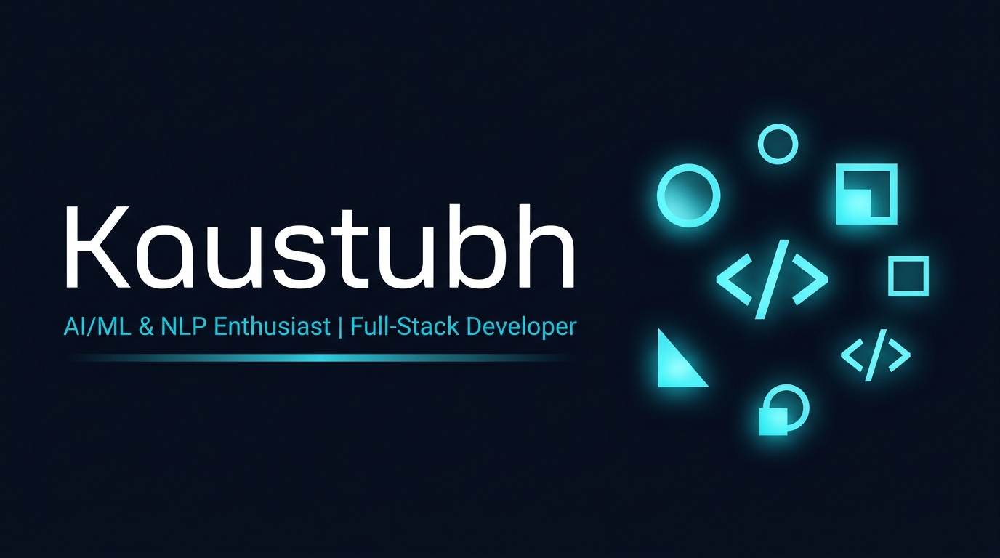

# Kaustubh Bodkhe — Portfolio 🚀

A modern, responsive personal portfolio website built with React 18, Vite, Framer Motion, and Tailwind CSS, featuring an interactive 24fps canvas-based portrait video player.



## ✨ Features

- **24 FPS Canvas Video Player** — Preloaded WebP frame sequences rendered in real-time on HTML5 canvas with background caching and viewport-pause optimization
- **Dark/Light Mode** — Persistent theme toggle with smooth transitions
- **Responsive Design** — Mobile-first, fluid layout across all devices
- **Scroll Animations** — Subtle reveal effects with Framer Motion
- **Typing Animation** — Dynamic role cycling in the hero section
- **Interactive Project Modals** — Click any project card for architecture details, problems solved, and learnings
- **Working Contact Form** — Honeypot spam filtering, direct Formspree integration and direct mailto link
- **Printable ATS Resume** — Embedded single-page PDF resume ready for download
- **SEO & Social Sharing** — Complete Open Graph, Twitter Cards, SVG favicon, and sitemap

## 🛠 Tech Stack

| Tool | Purpose |
|---|---|
| React 18 | UI component framework |
| Vite 6 | Lightning-fast build tool & dev server |
| Tailwind CSS 3 | Utility-first responsive styling |
| Framer Motion | Scroll-driven and entrance animations |
| React Icons | Minimalist feather icons |
| Sharp | Image and video frame optimization |
| Formspree | Serverless contact form handling |

## 🚀 Quick Start

```bash
# 1. Install dependencies
npm install

# 2. Set up environment variables (optional, for contact form)
cp .env.example .env
# Edit .env and add your Formspree form ID

# 3. Start the dev server
npm run dev

# 4. Build for production
npm run build
```

Open [http://localhost:5173](http://localhost:5173) in your browser.

## 📝 Configuration

All personal information, project data, skills, and links are centralized in:  
`src/data/config.js`

## 📂 Folder Structure

```
my-portfolio/
├── public/
│   ├── favicon.svg              ← Browser icon
│   ├── og-image.png             ← Social share card
│   ├── photo.jpg                ← High-resolution square portrait
│   ├── resume.pdf               ← ATS-friendly single-page PDF resume
│   ├── sitemap.xml              ← Search engine index
│   ├── projects/                ← Project screenshots
│   └── video-frames/            ← Compressed 24fps WebP frames (1-192)
├── src/
│   ├── components/
│   │   ├── Navbar.jsx           ← Sticky navigation with active tracking
│   │   ├── Hero.jsx             ← Hero section with 24fps canvas video
│   │   ├── FramePlayer.jsx      ← Canvas frame sequence player
│   │   ├── About.jsx            ← Background, focus, and profile photo
│   │   ├── Skills.jsx           ← Categorized tech stack grid
│   │   ├── Projects.jsx         ← Projects showcase cards
│   │   ├── ProjectModal.jsx     ← In-depth project popup dialog
│   │   ├── Education.jsx        ← Timeline & academic certifications
│   │   ├── Contact.jsx          ← Validated contact form
│   │   ├── Footer.jsx           ← Copyright and social icons
│   │   ├── ThemeToggle.jsx      ← Dark / Light theme switch
│   │   ├── ScrollReveal.jsx     ← Viewport-triggered animations
│   │   └── SectionHeading.jsx   ← Consistent section title styling
│   ├── data/
│   │   └── config.js            ← All site content and configuration
│   ├── hooks/
│   │   └── useTypewriter.js     ← Text-cycling typewriter hook
│   ├── App.jsx                  ← Main portfolio assembly
│   ├── main.jsx                 ← React entrypoint
│   └── index.css                ← Tailwind directives & custom CSS
├── package.json
└── vite.config.js
```

## 📄 License

MIT — Feel free to use this template for your own portfolio.
